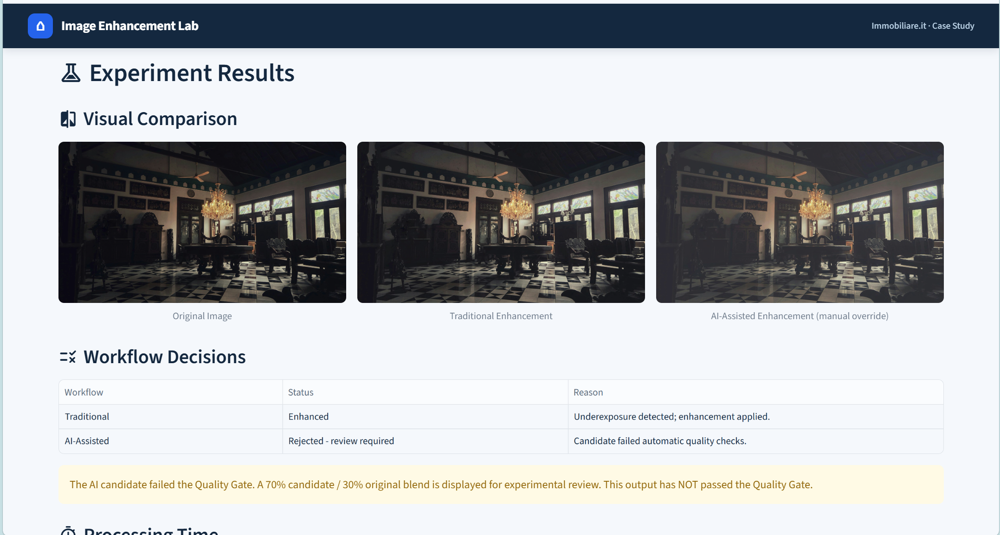

# Image Enhancement Lab

**Case Study | Immobiliare.it**

Prototipo locale sviluppato con Streamlit per **confrontare due workflow di miglioramento delle fotografie immobiliari**, valutandone qualità visiva, fedeltà, tempi e affidabilità. L'obiettivo è supportare la scelta tra fotografia originale e versione elaborata, evitando modifiche inutili o potenzialmente ingannevoli.

## 1. Perimetro e funzionamento

Il prototipo elabora fotografie JPG/PNG di interni, applicando correzioni controllate di luminosità e contrasto. Sono escluse modifiche strutturali, aggiunta o rimozione di oggetti, virtual staging e integrazione con Immobiliare.it.

L'utente carica una fotografia e avvia **Run Experiment**, che esegue due workflow sulla stessa immagine:

- **A — Traditional:** valuta l'esposizione con regole deterministiche e, se necessario, applica correzioni gamma e CLAHE tramite OpenCV.
- **B — AI-Assisted:** Gemini 3.5 Flash-Lite analizza una copia ridimensionata della foto e suggerisce parametri controllati, applicati localmente da OpenCV senza generare nuovi contenuti.

Entrambi possono decidere di **mantenere l'originale**. L'interfaccia mostra le tre versioni affiancate, con metriche, tempi, decisioni, avvisi e possibilità di download.

Un **Quality Gate sperimentale** controlla perdite di contrasto, gamma dinamica e clipping. Le candidate AI rifiutate possono essere visualizzate per revisione manuale attraverso un blending (70% candidata, 30% originale), senza che questo equivalga all'approvazione del controllo.

## 2. Parametri e metodo di valutazione

La valutazione combina **metriche quantitative** (luminosità, contrasto, nitidezza stimata, ombre, clipping, gamma dinamica, variazioni rispetto all'originale e tempi di elaborazione) e **giudizi qualitativi**.

Ogni output riceve un punteggio da **1 a 5** per:

- **Qualità visiva:** leggibilità e resa complessiva.
- **Naturalezza:** plausibilità di luce, colori e contrasto.
- **Fedeltà percepita:** conservazione delle caratteristiche visibili dell'immobile.

Il valutatore segnala eventuali alterazioni ingannevoli, seleziona la versione preferita e può motivare la scelta. I risultati sono registrati in `results/experiments.csv`.

## 3. Esperimenti e risultati

Sono state analizzate **6 fotografie (18 record)** da un unico valutatore non in cieco. Le preferenze sono state equamente distribuite: **2 Original, 2 Traditional, 2 AI-Assisted**.

| Indicatore | Traditional | AI-Assisted |
|---|---:|---:|
| Punteggio qualitativo medio (1–5) | **4,50** | 4,44 |
| Tempo medio | **0,63 s** | 3,54 s |
| Candidate rifiutate | 0 | 1 |

L'AI ha richiesto circa **5,6 volte** il tempo del metodo tradizionale, senza ottenere un vantaggio complessivo nelle preferenze. I risultati sono esplorativi e non statisticamente generalizzabili.

**Decisione preliminare:** utilizzare Traditional come soluzione di riferimento rapida e AI-Assisted come alternativa sperimentale, mantenendo la revisione umana e la possibilità di non modificare la foto.

## 4. Strumenti e componenti reali o simulati

**Stack:** Python 3.12, Streamlit, OpenCV, Pillow, NumPy, Pandas, Gemini API (`google-genai`) e CSV.

**Reali:** elaborazioni fotografiche, chiamate Gemini, misurazioni, valutazioni umane e salvataggio dei risultati.

**Sperimentali/non validati:** soglie del Quality Gate, blending delle candidate rifiutate e valutazione soggettiva della fedeltà. Non sono stati simulati risultati sperimentali né misurati benefici commerciali sugli annunci.

## 5. Limiti e sviluppi futuri

I principali limiti sono il **campione ridotto**, l'assenza di valutazioni cieche e di verifica della fedeltà rispetto all'immobile reale, le soglie euristiche e la dipendenza da un'API esterna. Le metriche numeriche non garantiscono la correttezza della rappresentazione fotografica.

Il workflow AI invia una copia ridimensionata della foto a Google: occorrono immagini autorizzate e una chiave API mantenuta privata. L'utilizzo del livello gratuito non costituisce una stima dei costi di produzione.

**Prossimi passi:** ampliare il dataset, coinvolgere più valutatori in cieco, validare il Quality Gate, misurare costi e affidabilità su scala maggiore e verificare l'eventuale impatto sugli annunci con esperimenti di prodotto.

## Documentazione

[Perimetro](docs/product_scope.md) · [Architettura](docs/architecture.md) · [Esperimenti](docs/experiments.md) · [Avvio del prototipo](docs/setup.md)
### Anteprima del prototipo

